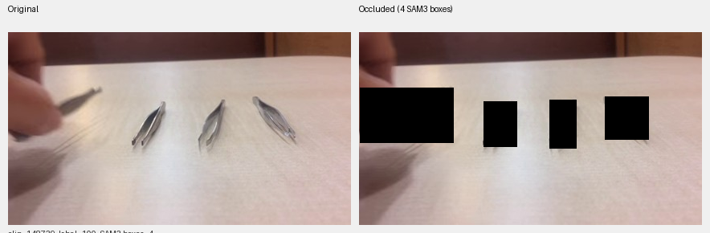
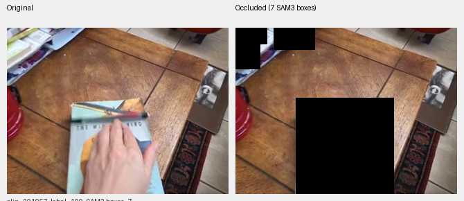
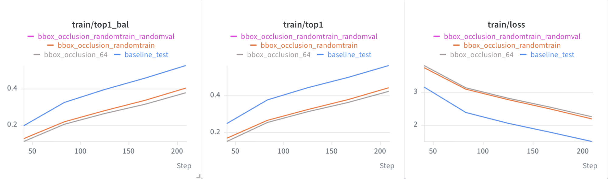
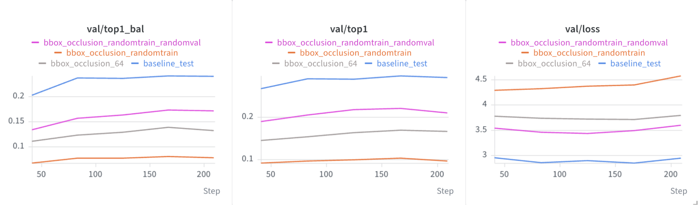

# Center Frame Object Bias Probing

**Purpose:**  
To investigate whether action recognition models rely on spatial object shortcuts (appearance bias) rather than actual temporal motion dynamics. This experiment tests the hypothesis that models can "cheat" by classifying actions based solely on static objects present in a single center frame.

**Experimental Setup:**  
- Extracted center frames from the Something-Something v2 (SSv2) video dataset to create an image-based action classification benchmark.
- Built an automated object occlusion pipeline to generate two dataset variants: original uncensored center frames and object-occluded center frames.
- Trained attentive probe classifiers on both dataset variants across all action classes to compare performance drops.

**Efficiency measures:**  
- Center frames extracted and cached for all videos.
- Bounding boxes detected with SAM3 for all videos and coordinates saved in a cocojson file.
- The Dataset class used pre extracted center frames and the cocojson file during training.

 

A few examples showing SAM3's bounding box detections with scores on ssv2 center frames:
 

 

A few examples showing how the automated object occlusion pipeline produces occluded images:

 

 

**Models & Algorithms:**  
- **DINOv2:** Frozen backbone used for dense feature extraction on center frames.
- **SAM3 (Segment Anything Model 3):** Used for automated, high-precision bounding box detection and object masking.
- **PyTorch:** Attentive probe classifier training:
 

Learning Curves:

 

**Results:**  
The baseline model trained on uncensored frames significantly outperformed the model trained on the SAM3-occluded dataset. This confirmed the hypothesis that models heavily rely on spatial object cues when limited to single-frame representations.

