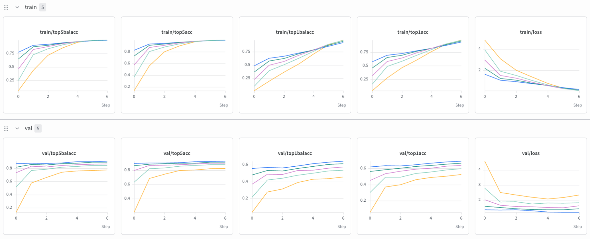
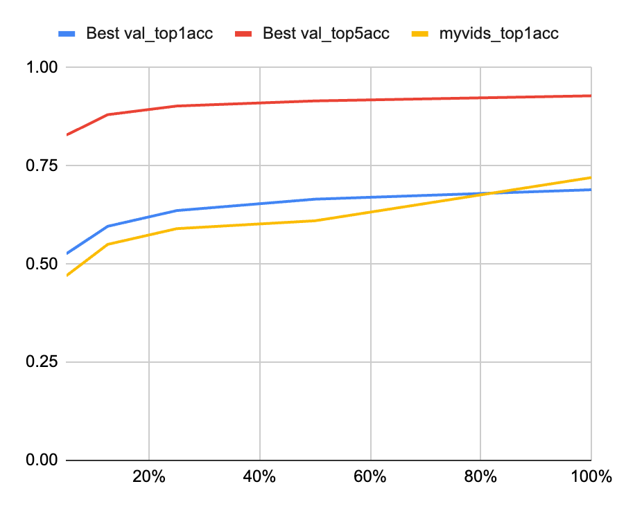

# Object Bias Probing: V-JEPA2-Base Scaling Experiments

**Purpose:**  
To test if a smaller, more efficient video foundation model (Base vs. Giant) retains resistance to object bias, and to systematically map how probe test performance scales with varying fractions of training data.

**Experimental Setup:**  
- Processed 174 SSv2 action classes using fast video decoding and serialized dense feature embeddings into sharded HDF5 files to prevent cluster memory bottlenecks.
- Deployed training jobs across remote HPC cluster nodes (Slurm).
- Trained cross-attention probes on varying dataset splits: 100%, 50%, 25%, 12.5%, and 5% of the training data, keeping the validation set fixed.

**Models & Algorithms:**  
- **V-JEPA 2.1 Base:** Video encoder backbone.
- **Data Pipeline:** PyAV, Decord, HDF5 (h5py).
- **Optimization:** AdamW optimizer, Cosine Annealing LR schedule.

**Learning Curves:**

**Results:**  
The V-JEPA2-Base model achieved highly comparable results to the larger G-variant, showing no emergent object bias upon granular inspection. Test set performance improved predictably and smoothly as the training set size increased.

|  | ssv2 |  |  |  | Myvideos w/ distractors – 80 vids |
| :---- | ----- | :---- | :---- | :---- | :---- |
| model | **Training data % used** | **Best val\_top5acc** | **Best val\_top1acc** | **test\_top1acc** | **myvids\_top1acc** |
| 261016\_1132 | 5% | 0.828 | 0.526 | 0.516 | 0.47 |
| 261015\_1447 | 12.5% | 0.880 | 0.596 | 0.590 | 0.55 |
| 261015\_1637 | 25% | 0.902 | 0.636 | 0.632 | 0.59 |
| 261015\_2059 | 50% | 0.915 | 0.665 | 0.664 | 0.61 |
| 261016\_0853 | 100% | 0.928 | 0.689 | 0.683 | 0.72 |

 

